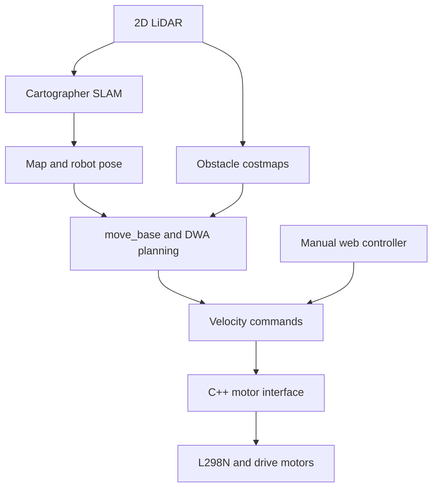
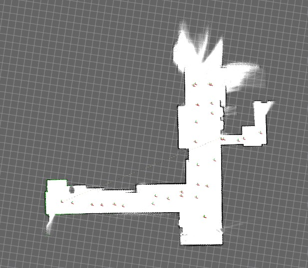

# Autonomous Mobile Robot

A Raspberry Pi mobile robot integrating LiDAR-based mapping, autonomous navigation, and browser-based manual control through ROS 1.

**Bachelor's thesis · ROS Noetic · C++ · Python · 2D SLAM**


[Navigation demo](media/navigation.mp4) · [Manual-control demo](media/web_control.mp4) · [Generated map](media/map.jpg) · [Hardware view](media/robot_left.jpg)

## Problem & Motivation

An indoor mobile robot needs sensing, localization, planning, and motor control to work together. This project explores that integration on a Raspberry Pi platform with a 2D LiDAR and differential-drive motors.

The engineering objective was to build a physical robot that maps indoor space, supports navigation through the ROS stack, and allows manual driving from a browser. The project was developed as a bachelor's thesis in Electrical and Electronics Engineering at Ege University.

## Approach

The work combines physical hardware integration, ROS launch and configuration files, a motor-control interface, and a web controller. Mapping and planning use existing Cartographer and ROS navigation components.



### Mapping and navigation

- The YDLIDAR X2 supplies `/scan` data to Cartographer for 2D mapping and pose estimation.
- `move_base` uses a Navfn global planner, DWA local planner, and obstacle costmaps to generate velocity commands.
- Launch files and configuration connect the `map`, `base_link`, and `laser` frames.
- The navigation launch starts live Cartographer mapping alongside planning; it does not implement a separate saved-map localization mode.

### Motor control and manual operation

The current C++ implementation separates differential-drive command mixing, GPIO operations, and the ROS node. It translates `/cmd_vel` messages into motor direction and PWM demand, bounds commands, scales saturation proportionally, and stops the motors when valid commands stop arriving. The default watchdog timeout is 500 ms.

Control is open-loop: command velocities are mapped to PWM demand, without wheel-encoder feedback or closed-loop speed control. The Python Flask interface publishes manual velocity commands to the same topic. Manual control and autonomous navigation are operated separately because no command multiplexer is included.

See [software architecture](docs/architecture.md) and [hardware wiring](docs/hardware.md) for component interfaces and configuration details.

## Technologies

| Component | Technology and purpose |
|---|---|
| Compute | Raspberry Pi 4B |
| Sensor | YDLIDAR X2 2D LiDAR |
| Drive hardware | L298N dual H-bridge, two DC gear motors, and caster |
| Middleware | ROS 1 Noetic on Ubuntu 20.04 |
| Mapping | Google Cartographer 2D |
| Planning | `move_base`, Navfn, DWA, and ROS costmaps |
| Motor interface | C++14, `roscpp`, and the `pigpio` C library |
| Manual interface | Python, `rospy`, and Flask |
| Build and tests | catkin, CMake, and GoogleTest mixer tests |

## How to Run

### 1. Prepare the target hardware

Use a Raspberry Pi with Ubuntu 20.04, ROS Noetic, the wired motor driver, and a compatible LiDAR driver. Follow the [hardware notes](docs/hardware.md) for BCM pin numbering, power connections, motor-enable jumpers, and LiDAR placement.

Required software includes:

- ROS packages: `roscpp`, `rospy`, `geometry_msgs`, `robot_state_publisher`, `cartographer_ros`, `move_base`, `dwa_local_planner`, and `navfn`.
- The `pigpio` C library and development headers, with the GPIO permissions required by the target Pi installation.
- Python Flask for manual control and RViz for interactive navigation goals.
- A YDLIDAR-compatible driver configured to publish `/scan` with the `laser` frame.

The LiDAR driver and operating-system setup are not bundled. The package requires `pigpio` at CMake configuration time, so a generic laptop build is not provided by this setup.

### 2. Clone and build

Run in a terminal with ROS Noetic installed:

```bash
source /opt/ros/noetic/setup.bash
mkdir -p ~/catkin_ws/src
cd ~/catkin_ws/src
git clone https://github.com/pashaeimehran/autonomous-mobile-robot.git
cd ~/catkin_ws
catkin_make
source devel/setup.bash
```

In each additional ROS terminal, source the ROS installation and workspace:

```bash
source /opt/ros/noetic/setup.bash
source ~/catkin_ws/devel/setup.bash
```

### 3. Select one operating mode

Start the ROS master in a separate terminal:

```bash
roscore
```

For mapping or navigation, start the separately installed LiDAR driver using its configured launch file. Confirm that `/scan` is available:

```bash
rostopic hz /scan
```

Then run **one** of the following modes. Mapping and navigation already include robot bringup.

| Mode | Command |
|---|---|
| Motor interface and robot description only | `roslaunch autonomous_mobile_robot bringup.launch` |
| Live 2D mapping | `roslaunch autonomous_mobile_robot mapping.launch` |
| Live mapping and autonomous navigation | `roslaunch autonomous_mobile_robot navigation.launch` |

For navigation, start RViz in another sourced terminal, set its fixed frame to `map`, add map and laser displays, and use **2D Nav Goal** to select a destination after the map and transforms are available. An RViz configuration file is not included.

### 4. Use manual control

Start `bringup.launch` with autonomous navigation inactive. In another sourced terminal:

```bash
cd ~/catkin_ws/src/autonomous-mobile-robot
python3 web/app.py
```

Open `http://127.0.0.1:5000` in a browser on that machine. The interface supports arrow keys and on-screen controls. It binds to loopback by default; remote access is not configured by these commands.

### 5. Run the mixer tests

On a system where the package builds successfully:

```bash
cd ~/catkin_ws
catkin_make run_tests_autonomous_mobile_robot
catkin_test_results build/test_results
```

The tests cover drive-command mixing, saturation, and invalid inputs. They do not exercise GPIO or validate complete robot navigation. The build still requires the package's ROS and `pigpio` dependencies.

## Results & Validation Scope

### Original project demonstrations

| Artifact | Evidence available |
|---|---|
| [Navigation video](media/navigation.mp4) | Recorded physical-robot navigation demonstration |
| [Manual-control video](media/web_control.mp4) | Recorded browser-based manual driving |
| [Generated map](media/map.jpg) | Example mapping output |
| [Robot photographs](media/robot_left.jpg) | Physical platform and hardware integration |



These artifacts document the original thesis project. The repository now contains a modular C++ motor-control implementation added during a later refactoring. The original demonstrations should not be treated as hardware validation of that later implementation; a new hardware run of the current C++ version is not documented here.

### Current limitations

- No quantified navigation success rate, localization error, or trajectory benchmark is supplied.
- The motor interface does not publish wheel odometry or estimate measured wheel velocity. Motion estimates available to the local planner are therefore limited.
- Mapping is configured without encoder odometry or an IMU.
- Manual and navigation commands share `/cmd_vel` and must not be used concurrently.
- The software watchdog handles missing commands; it is not an electrical emergency stop.

## Repository Guide

| Path | Purpose |
|---|---|
| [`include/motor_driver.h`](include/motor_driver.h) | Drive mixer, command types, and GPIO interface |
| [`src/motor_driver.cpp`](src/motor_driver.cpp) | Direction and PWM control |
| [`src/motor_driver_node.cpp`](src/motor_driver_node.cpp) | ROS subscriber, parameters, and watchdog |
| [`test/test_motor_mixing.cpp`](test/test_motor_mixing.cpp) | Motor-mixing unit tests |
| `config/` | Mapping, costmap, and planner parameters |
| `launch/` | Bringup, mapping, and navigation modes |
| `urdf/` | Robot and sensor transforms |
| `web/` | Flask controller and browser interface |
| `docs/` | Architecture and hardware notes |
| `media/` | Photographs, map, and demonstration videos |

## Academic Context

Bachelor's thesis as part of the national 2209-A University Student Research Support Programme (TÜBİTAK) in Electrical and Electronics Engineering, Ege University. Supervised by Prof. Dr. Musa Alcı. 
