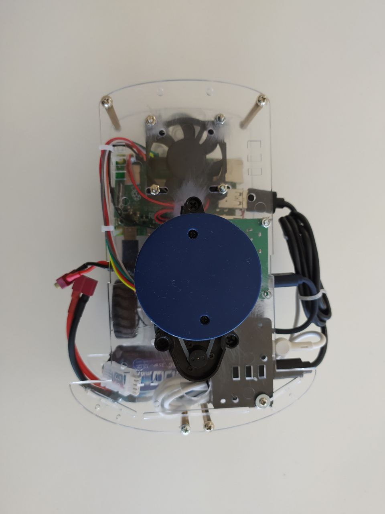
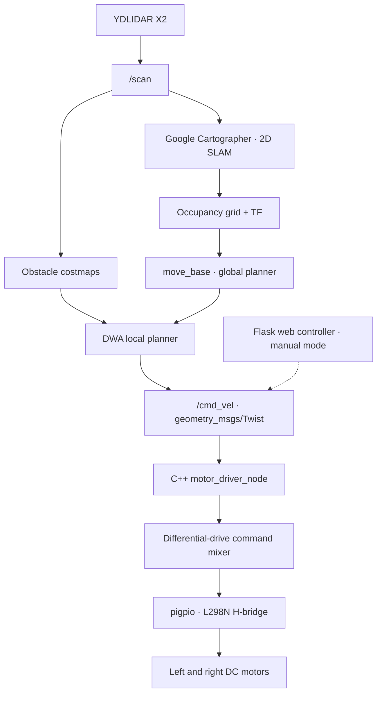

# Autonomous Mobile Robot

**2D SLAM · Autonomous Navigation · ROS 1 · C++ Motor Control**  
Bachelor's thesis in Electrical and Electronics Engineering, Ege University

A two-wheel-drive mobile robot designed and built around a Raspberry Pi 4B, a 2D LiDAR, and an L298N motor driver. The robot maps indoor environments with Google Cartographer, navigates with the ROS navigation stack, and supports browser-based manual driving.



[**Navigation demo**](media/navigation.mp4) · [**Web control demo**](media/web_control.mp4) · [**Generated map**](media/map.jpg) · [**Robot hardware**](media/robot_left.jpg)

| Hardware | Software | Control |
|---|---|---|
| Raspberry Pi 4B, YDLIDAR X2, L298N, two DC gear motors and caster | ROS Noetic, Cartographer 2D, `move_base`, DWA, Flask | `/cmd_vel` to independent motor direction and PWM outputs |

## System architecture



The navigation and manual-control interfaces publish to the same velocity-command topic. They are operated in separate modes to avoid competing motor commands.

## Engineering design

### Mapping and navigation

- **Laser-based mapping:** Cartographer builds a 2D occupancy map from `/scan`, with the LiDAR pose fixed relative to `base_link` in the robot description.
- **Path planning:** `move_base` combines a global path with DWA local trajectory selection and obstacle costmaps.
- **ROS integration:** Package-relative launch files, a consistent `map` / `base_link` / `laser` frame convention, and centralized planner parameters.

### Motor control

The motor interface translates ROS `geometry_msgs/Twist` commands into H-bridge direction signals and PWM duty cycles. Control is open-loop: command velocities are mapped to PWM demand rather than estimated from wheel encoders.

```text
left  = linear.x * linear_gain - angular.z * angular_gain
right = linear.x * linear_gain + angular.z * angular_gain
```

The C++ implementation separates the drive-command mixer from Raspberry Pi GPIO operations and ROS message handling:

- Signed wheel demands determine direction; PWM uses the absolute magnitude.
- Linear and angular commands are bounded, with proportional scaling when either wheel exceeds 100% duty.
- An independent 500 ms watchdog stops the motors when velocity commands stop arriving.
- Input validation, GPIO shutdown handling, and focused unit tests cover the motor-control path.

| Component | Responsibility |
|---|---|
| [`include/motor_driver.h`](include/motor_driver.h) | Differential-drive mixing, motor command types, GPIO interface |
| [`src/motor_driver.cpp`](src/motor_driver.cpp) | L298N direction control and `pigpio` PWM output |
| [`src/motor_driver_node.cpp`](src/motor_driver_node.cpp) | ROS subscriber, configuration parameters, watchdog |
| [`test/test_motor_mixing.cpp`](test/test_motor_mixing.cpp) | Forward/reverse, turning, saturation, and input validation |

## Repository structure

```text
.
├── include/       # C++ motor-control interfaces
├── src/           # Motor driver and ROS node
├── test/          # C++ unit tests
├── config/        # Cartographer, costmap, and DWA parameters
├── launch/        # Bringup, mapping, and navigation
├── urdf/          # Robot and LiDAR transforms
├── web/           # Flask controller and HTML interface
├── docs/          # Architecture and wiring notes
├── media/         # Robot images, map, and demonstration videos
├── CMakeLists.txt
└── package.xml
```

## ROS interfaces

| Topic / frame | Type | Purpose |
|---|---|---|
| `/scan` | `sensor_msgs/LaserScan` | LiDAR input for SLAM and costmaps |
| `/map` | `nav_msgs/OccupancyGrid` | Cartographer map output |
| `/cmd_vel` | `geometry_msgs/Twist` | Navigation or web-control motor commands |
| `map → base_link → laser` | TF | Robot pose and fixed sensor transform |

## Build and usage

**Target platform:** Ubuntu 20.04, ROS 1 Noetic, Raspberry Pi with the `pigpio` C library and development headers. ROS dependencies include `roscpp`, `geometry_msgs`, `robot_state_publisher`, `cartographer_ros`, `move_base`, `dwa_local_planner`, and `navfn`. A compatible LiDAR driver must publish `/scan`.

Clone the package into a catkin workspace and build:

```bash
cd ~/catkin_ws
catkin_make
source devel/setup.bash
```

Start the required LiDAR driver separately, then use one of these ROS launch files:

```bash
roslaunch autonomous_mobile_robot bringup.launch
roslaunch autonomous_mobile_robot mapping.launch
roslaunch autonomous_mobile_robot navigation.launch
```

`bringup.launch` starts the robot description publisher and motor node. The mapping launch adds Cartographer; navigation adds `move_base` and DWA. **Select one launch mode rather than running all three together.**

For manual control, start the robot bringup and launch the Flask application in a separate shell while autonomous navigation is inactive:

```bash
python3 web/app.py
```

The browser interface defaults to `127.0.0.1:5000`; keyboard arrows and on-screen controls send velocity commands while pressed. See [architecture](docs/architecture.md) and [hardware wiring](docs/hardware.md) for integration details and GPIO pin assignments.

## Project demonstrations

The demonstration videos show mapping, navigation, and browser-based manual control of the physical robot. The repository includes a modular C++ ROS motor-control implementation.

Bachelor's thesis supervised by **Prof. Dr. Musa Alcı**, Ege University.
